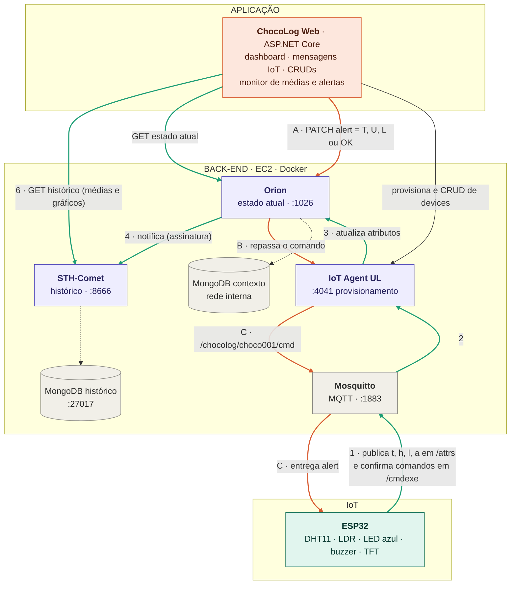

# ChocoLog IoT

Monitoramento ambiental de cargas de chocolate com ESP32 e FIWARE. Continuação do [ChocoLog](https://github.com/ouxnq/chocolog), que era um data logger autônomo em Arduino Uno: agora as medidas vão para a nuvem, ficam no histórico e uma aplicação web decide quando a carga está em risco.

Projeto N2 de Sistemas Embarcados (Prof. Fábio Cabrini) e Linguagem de Programação I (Prof. Eduardo Rosalém), Engenharia de Computação, FESA.

## Objetivo

Medir temperatura, umidade e luminosidade dentro da carga, guardar o histórico e avisar quando o chocolate corre risco. A aplicação calcula a média das últimas medidas e, se alguma grandeza sair do limite, manda o ESP32 piscar o LED azul e tocar o buzzer num ritmo e num tom próprios de cada grandeza. Com tudo dentro dos limites, LED e buzzer ficam desligados.

## Arquitetura

A aplicação nunca fala direto com o ESP32. Ela lê o estado no Orion, consulta o histórico no STH-Comet e envia o comando ao Orion, que o repassa ao IoT Agent e ao ESP32 por MQTT. Verde é telemetria (1 a 6), laranja é comando (A a C).



| Passo | De → para | Protocolo | O que trafega |
|---|---|---|---|
| 1 | ESP32 → Mosquitto | MQTT :1883 | `t\|19.5\|h\|52\|l\|12` a cada 5 s e `a\|T` (alerta que está tocando) |
| 2, 3 | Mosquitto → IoT Agent → Orion | MQTT, NGSI-v2 | o IoT Agent traduz `t h l a` para `temperature humidity luminosity alertState` |
| 4, 5 | Orion → STH-Comet → MongoDB | HTTP | a assinatura avisa o STH-Comet, que guarda cada medida |
| 6 | Aplicação → STH-Comet | HTTP :8666 | últimas medidas para as médias, os gráficos e a consulta de mensagens |
| A | Aplicação → Orion | HTTP :1026 | `PATCH` com `alert = T, U, L ou OK` |
| B, C | Orion → IoT Agent → ESP32 | NGSI-v2, MQTT | `choco001@alert\|T` em `/chocolog/choco001/cmd`; o ESP32 confirma em `/cmdexe` |

O FIWARE (Orion, IoT Agent, STH-Comet, Mosquitto e MongoDB) é o do repositório [FIWARE Made Simple](https://github.com/fabiocabrini/fiware-made-simple), sem alterações.

## Componentes e pinagem

| Componente | Pino do ESP32 | Observação |
|---|---|---|
| ESP32 DevKit V1 | | placa "DOIT ESP32 DEVKIT V1" na Arduino IDE |
| DHT11 | GPIO 27 | temperatura (°C) e umidade (%) |
| LDR (módulo ou LDR + resistor 10 kΩ) | GPIO 34 | precisa ser um pino ADC1 (GPIO 32 a 39): os ADC2 param com o Wi-Fi ligado |
| LED azul + resistor 220 Ω | GPIO 26 | alerta visual |
| Buzzer **passivo** | GPIO 25 | só o passivo muda de tom; um buzzer ativo apita sempre no mesmo tom |
| Display TFT 1.8" ST7735 (opcional) | SCK 18, SDA 23, CS 5, A0/DC 16, RESET 17 | VCC e LED no 3V3; mostra as medidas e o alerta |

Os pinos ficam no começo do firmware (`PIN_DHT`, `PIN_LDR`, `PIN_LED`, `PIN_BUZZER`), com um comentário em cada um. Sem o display, mude `USE_TFT` para `0`.

**Escala do LDR:** 0 % = escuro, 100 % = muito claro. O firmware faz a média de 16 leituras do ADC (0 a 4095) e converte com `map()` entre `LDR_RAW_DARK` e `LDR_RAW_BRIGHT`. Para calibrar, digite `ldr` no Monitor Serial com o sensor tampado e depois iluminado, e coloque os dois valores brutos nessas constantes. Se o valor subir no escuro, troque os dois de lugar.

## Limites e alertas

Os limites são os do `chocolog.ino` original e podem ser mudados na tela Limites da aplicação, sem regravar nada.

| Grandeza | Faixa aceita |
|---|---|
| Temperatura | 15 a 22 °C |
| Umidade | 45 a 60 % |
| Luminosidade | até 50 % (acima disso, a embalagem pode ter sido aberta) |

**Janela da média:** as últimas 12 medidas de cada grandeza no STH-Comet, ou seja, o último minuto (o ESP32 publica a cada 5 s). A aplicação recalcula a cada 10 s e só envia comando quando a decisão muda.

**Prioridade:** com mais de uma grandeza fora do limite, vale a de maior prioridade: temperatura, depois umidade, depois luminosidade. O calor derrete o chocolate; umidade e luz estragam mais devagar.

| Prioridade | Condição (média da janela) | Comando | LED azul | Buzzer |
|---|---|---|---|---|
| 1 | temperatura abaixo de 15 ou acima de 22 °C | `T` | pisca 4 vezes por segundo | 2500 Hz, junto com o LED |
| 2 | umidade abaixo de 45 ou acima de 60 % | `U` | pisca 2 vezes por segundo | 1200 Hz, junto com o LED |
| 3 | luminosidade acima de 50 % | `L` | pisca 1 vez por segundo | 600 Hz, junto com o LED |
| | tudo dentro dos limites | `OK` | apagado | mudo |

## Deploy no AWS Learner Lab

1. No AWS Academy, abra o **Learner Lab**, clique em **Start Lab** e espere a bolinha ficar verde. Em **AWS Details**, baixe a chave (`Download PEM`, arquivo `labsuser.pem`). Clique em **AWS** para abrir o console.

2. Em **EC2 > Instâncias > Executar instância**:
   * Nome: `chocolog-fiware`
   * Imagem: **Ubuntu Server 24.04 LTS** (x86_64; o FIWARE não roda em ARM)
   * Tipo: **t3.medium** (4 GB de memória; o t3.small também serve)
   * Par de chaves: **vockey**
   * Armazenamento: **20 GB**

3. Em **Configurações de rede > Editar**, crie um grupo de segurança com estas regras de entrada (tipo TCP personalizado). Libere só para o IP da rede de vocês (opção **Meu IP**), nunca para todo mundo:

   | Porta | Serviço | Quem usa |
   |---|---|---|
   | 22 | SSH | vocês, para instalar |
   | 1883 | Mosquitto (MQTT) | ESP32 |
   | 1026 | Orion | aplicação |
   | 4041 | IoT Agent | aplicação (provisionamento e devices) |
   | 8666 | STH-Comet | aplicação (histórico) |

   Celular no 4G ou rede que muda de IP: dá para usar **Qualquer lugar (0.0.0.0/0)** só durante a apresentação, e remover depois.

4. Inicie a instância, anote o **Endereço IPv4 público** e entre por SSH (no PowerShell, na pasta do `labsuser.pem`):

   ```bash
   ssh -i labsuser.pem ubuntu@IP_DA_EC2
   ```

5. Na EC2, instale e suba o FIWARE (o script instala o Docker se faltar; se ele pedir, saia com `exit`, entre de novo e rode o script outra vez):

   ```bash
   git clone https://github.com/fabiocabrini/fiware-made-simple.git
   cd fiware-made-simple
   ./scripts/check-requirements.sh
   docker compose up -d --wait
   ```

6. Provisione pelo Postman (service group, device e assinatura do histórico). Os nomes precisam ser estes, porque o firmware e a aplicação usam os mesmos:

   | Item | Valor |
   |---|---|
   | fiware-service / fiware-servicepath | `chocolog` / `/` |
   | apikey | `chocolog` |
   | device_id | `choco001` |
   | entity_name / entity_type | `urn:ngsi-ld:ChocoLog:001` / `ChocoLog` |
   | atributos (object_id → name) | `t` → `temperature`, `h` → `humidity`, `l` → `luminosity`, `a` → `alertState` |
   | comando | `alert` |

   Se o Postman usar outros nomes, troque no firmware (`APIKEY`, `DEVICE_ID`) e na tela Configuração da aplicação.

**A cada nova sessão do Learner Lab** a EC2 desliga e volta com outro IP. Os containers sobem sozinhos e o provisionamento continua salvo no MongoDB. Só é preciso trocar o IP em dois lugares: na tela Configuração da aplicação e no ESP32, digitando `ip NOVO_IP` no Monitor Serial.

## Como executar

**ESP32**

1. Na Arduino IDE, instale o pacote de placas `esp32` (Espressif) e as bibliotecas *PubSubClient*, *DHT sensor library* e, se usar o display, *Adafruit ST7735 and ST7789* e *Adafruit GFX*.
2. Abra `firmware/chocolog_iot/chocolog_iot.ino`, preencha `DEFAULT_SSID`, `DEFAULT_PASSWORD` e `DEFAULT_BROKER` (IP da EC2) e grave.
3. No Monitor Serial (115200, "Nova linha"): `status` mostra Wi-Fi, servidor e medidas; `ip`, `ssid` e `senha` trocam a configuração sem regravar.

**Aplicação**

ASP.NET Core MVC 3.1, como nas aulas. No Visual Studio, abra `app/ChocoLog.sln` e rode o projeto `ChocoLog.Web` (F5). Pelo terminal, com o SDK do .NET instalado:

```bash
cd app/ChocoLog.Web
dotnet run --urls http://localhost:5080
```

Abra `http://localhost:5080`. Na primeira vez, vá em **Configuração** e coloque o IP da EC2. As APIs do dashboard ficam documentadas em `/swagger`.

**Sem AWS e sem ESP32 (simulador)**

Para testar ou ensaiar a apresentação no próprio PC: com o [Node.js 20+](https://nodejs.org) instalado, rode `scripts/simular.cmd` (ou `node simulador/simulador.mjs`). Ele imita o Orion, o IoT Agent, o STH-Comet e o ESP32. Na aplicação, use o servidor `localhost` e clique em **Provisionar tudo**. Em `http://localhost:8090` fica o ESP32 virtual, com botões para provocar cada alerta e o LED piscando no ritmo certo. Ele não testa o MQTT nem o firmware de verdade.

## Aplicação (ASP.NET Core MVC)

Segue o padrão das aulas: `PadraoViewModel`, `PadraoDAO<T>` e `PadraoController<T>` (Index, Create, Save com `Operacao` I/A, Edit e Delete, com `ValidaDados` e `PreencheDadosParaView`). A diferença é que o DAO não usa stored procedures: cada método chama a API do FIWARE.

| Banco SQL (aulas) | ChocoLog (FIWARE) |
|---|---|
| `ConexaoBD` | `DAO/ConexaoFiware.cs`: IP e portas, editáveis na tela Configuração |
| `HelperDAO.ExecutaProc` | `DAO/HelperFiware.cs`: uma chamada HTTP com os cabeçalhos `fiware-service` e `fiware-servicepath` |
| `spInsert_`, `spUpdate_`, `spDelete`, `spConsulta_`, `spListagem_` | `POST`, `PATCH`, `DELETE` e `GET` em `/v2/entities` (Orion) ou `/iot/devices` (IoT Agent) |
| `CriaParametros` / `MontaModel` | `CriaAtributos` / `MontaModel` |

| Tela | Controller | O que faz | API do FIWARE |
|---|---|---|---|
| Dashboard | `Home` + `Api/Dashboard` | valores atuais, médias, alerta e um gráfico por grandeza, por AJAX a cada 5 s | Orion `GET /v2/entities/{id}` e STH `GET /STH/v1/contextEntities/...` |
| Cadastros > Cargas | `Carga` | CRUD das cargas de chocolate em transporte | Orion `/v2/entities` (tipo Carga) |
| Cadastros > Dispositivos | `Dispositivo` | CRUD dos devices ChocoLog | IoT Agent `/iot/devices` |
| Cadastros > Limites | `Limite` | limites e janela da média | Orion `POST /v2/entities?options=upsert` |
| Consultas > Mensagens IoT | `Mensagem` | filtro por grandeza, quantidade e período; o AJAX recebe a tabela pronta (`pvGridMensagens`) | STH-Comet |
| Configuração | `Configuracao` | IP do servidor, teste dos serviços (AJAX), provisionamento e assinaturas | IoT Agent `/iot/services`, Orion `/v2/subscriptions` |

As funções AJAX ficam em `wwwroot/js/site.js`, numeradas e comentadas. O monitor de alertas (`Services/MonitorAlertas.cs`) roda em segundo plano, mesmo sem nenhuma página aberta. A regra de decisão fica separada em `Services/RegraAlertas.cs`.

Não há banco de dados SQL: tudo fica no FIWARE (cargas e limites no Orion, histórico no STH-Comet), como permite o enunciado. Por isso não há script SQL na entrega.

## Estrutura

```
firmware/chocolog_iot/   código do ESP32
app/ChocoLog.Web/        aplicação ASP.NET Core MVC 3.1 (Controllers, DAO, Models, Services, Views, wwwroot)
simulador/               FIWARE e ESP32 simulados para testar sem a AWS
scripts/simular.cmd      atalho para o simulador no Windows
```

## Integrantes

| Nome | RA |
|---|---|
| | |
| | |
| | |
